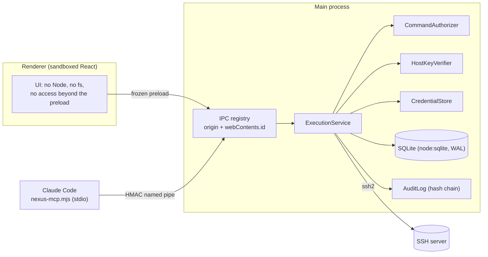

<div align="center">

# NEXUS Terminal

**A security-focused Windows SSH terminal with native command authorization, strict host-key
verification, and a restricted Claude Code MCP integration.**

[](https://github.com/ITS.R6Y/nexus-terminal/actions/workflows/windows-build.yml)
[](../../releases)

[](LICENSE)

[Download](../../releases) · [Quick start](#quick-start) · [Security](#security-architecture) · [Claude Code / MCP](#claude-code--mcp-setup) · [Docs](#documentation)

</div>

---

NEXUS is an Electron desktop SSH client built on one assumption: a terminal is a console on
someone else's machine, and the important security decisions should never be made inside a web
page. SSH connections, credentials, the database, the audit log, and every approval decision live
in the Electron **main process**. The UI is a sandboxed renderer that can only *ask*.

Created and maintained by **Ray**. MIT licensed.

## Contents

- [Why NEXUS](#why-nexus)
- [Quick start](#quick-start)
- [Capabilities](#capabilities)
- [Security architecture](#security-architecture)
- [Screenshots](#screenshots)
- [System requirements](#system-requirements)
- [Download and install](#download-and-install)
- [First launch](#first-launch)
- [Connecting to a server](#connecting-to-a-server)
- [Host-key verification](#host-key-verification)
- [Command authorization](#command-authorization)
- [Claude Code / MCP setup](#claude-code--mcp-setup)
- [Where your data lives](#where-your-data-lives)
- [Backup and restore](#backup-and-restore)
- [Upgrading](#upgrading) · [Uninstall](#uninstall)
- [Troubleshooting](#troubleshooting)
- [Security limitations](#security-limitations)
- [Building from source](#building-from-source)
- [Documentation](#documentation)
- [License and contributing](#license-and-contributing)

## Why NEXUS

Most SSH clients treat "trust this host key" and "run this command" as UI events. NEXUS treats
them as authorization decisions the UI is not allowed to make:

- **Host keys are pinned** per `(host, port, key type)` on first use. A *changed* key blocks the
  connection outright. There is no override, no setting, and no environment variable.
- **Commands run on your behalf** (from the Run Command drawer or from Claude Code through MCP)
  pass through one shared pipeline that raises a native OS dialog. The default answer is **Deny**.
- **Everything privileged** (SSH, credentials, SQLite, audit log) lives in main and is reachable
  from the renderer only through a frozen, origin-pinned preload surface.

NEXUS is not a general-purpose automation platform and does not try to be. It does one thing: it
gives you a defensible audit trail for the commands you send to a server, whether you typed them
or an assistant proposed them.

## Quick start

1. **Download** `NEXUS-Terminal-Setup.exe` from [Releases](../../releases) and verify it against
   `SHA256SUMS.txt` (see [Download and install](#download-and-install)).
2. **Run the installer.** It is per-user and needs no administrator rights. Because 1.0.0 is
   unsigned, read the [SmartScreen note](#about-the-smartscreen-warning) first.
3. **Add a server** under *Servers → Add server*, connect, and approve the host key after
   checking its fingerprint.
4. *(Optional)* Open **Claude / MCP** in the app and register the shown command with Claude Code.

## Capabilities

| Area | What you get |
| --- | --- |
| Terminal | Full interactive PTY over `ssh2` with xterm.js: resize, search-in-buffer, scrollback |
| Servers | Saved hosts with per-server key path, passphrase handling, and a per-server MCP access toggle |
| Authorization | Native approve/deny dialog for every programmatic command, hashed arguments, 60 s timeout |
| Host keys | Strict verification, first-use prompt, hard block on mismatch, editable Known Hosts list |
| History | Command history with retention pruning; approval records; append-only hash-chained audit log |
| Audit log | SHA-256 chained `audit_log` with an in-app integrity verification action |
| Credentials | Windows Credential Manager via `@napi-rs/keyring`, `safeStorage` fallback, never plaintext |
| MCP | Exactly five tools for Claude Code, over an HMAC-authenticated local named pipe |
| Hardening | `nexus-app://` only, strict CSP, sandbox + context isolation, Electron fuses flipped |

## Security architecture



- **No `file://`.** The renderer is served from a custom privileged scheme, `nexus-app://app`, by
  a handler that rejects traversal, backslashes, NUL bytes and symlink escapes.
- **Strict CSP, pinned origin, pinned `webContents.id`.** Every IPC message is validated against
  both the trusted origin and the single expected window.
- **Native dialogs, main process only.** Approval and host-key prompts are OS dialogs whose default
  button is Deny/Reject. Neither the renderer nor MCP has an IPC path that resolves them.
- **The MCP process is deliberately thin.** It is built separately with `electron`, `ssh2`,
  `node:sqlite` and `@napi-rs/keyring` marked external, then scanned at build time to prove none of
  them were bundled. It has no database access and no SSH code.

Full detail: [`docs/SECURITY.md`](docs/SECURITY.md) (threat model and accepted limitations) and
[`docs/ARCHITECTURE.md`](docs/ARCHITECTURE.md) (data flows, channels, lifecycle).

## Screenshots

_Placeholders: captures will be added before the first public release._

| Dashboard | Terminal | Command approval |
| --- | --- | --- |
| _(screenshot pending)_ | _(screenshot pending)_ | _(screenshot pending)_ |

Native approval and host-key dialogs are OS windows, so they are documented as text rather than
marketing imagery.

## System requirements

| | |
| --- | --- |
| OS | Windows 11 x64 (primary target). Windows 10 x64 is expected to work but is not the tested target. |
| Disk | About 450 MB installed (Electron runtime included) |
| Network | Needed only to reach the SSH servers you connect to |
| Privileges | None. The installer is per-user and does not require administrator rights. |
| Prerequisites | **None.** No Node.js, npm, Python, compiler or build tools. The runtime is bundled. |

## Download and install

1. Download `NEXUS-Terminal-Setup.exe` from the [Releases](../../releases) page.
2. Verify the download against `SHA256SUMS.txt` from the same release:

   ```powershell
   Get-FileHash .\NEXUS-Terminal-Setup.exe -Algorithm SHA256
   ```

3. Run the installer. It installs for the current user only (no administrator prompt), lets you
   choose another directory, and creates Start Menu and desktop shortcuts named **NEXUS
   Terminal**.

**Archive alternative.** `NEXUS-Terminal-1.0.0-windows-x64-archive.zip` is the installed
application directory in a ZIP: extract it anywhere and run `NEXUS Terminal.exe`. It still stores
its data under `%APPDATA%\NEXUS`, so it is an unpacked build, **not** a self-contained portable
app. Choose it if you want to inspect the files or run without registering an installer.

### About the SmartScreen warning

Release `1.0.0` is **not code-signed**. Windows will likely show *"Windows protected your PC"*
when you run the installer, because SmartScreen reputation is tied to a signing certificate and to
download volume, and a brand-new unsigned binary has neither.

NEXUS will never ask you to turn off Microsoft Defender or SmartScreen. If you want to run it,
confirm the SHA-256 hash matches `SHA256SUMS.txt` on the release page, then choose
**More info → Run anyway**. If the hash does not match, do not run the file. Signed builds will
replace this section once a certificate is available; the plan is in
[`docs/DISTRIBUTION-ASSESSMENT.md`](docs/DISTRIBUTION-ASSESSMENT.md).

## First launch

The app opens on the **Dashboard**. On first run it creates its database and migrations, starts
the local audit log, and probes the credential backend. You can confirm the backend in the status
bar and in `%APPDATA%\NEXUS\logs\nexus.log`:

```json
{"level":"info","event":"app.started","meta":{"credentialBackend":"OS Keyring (@napi-rs/keyring)"}}
```

If the backend reads `safeStorage` instead, credentials are still encrypted (DPAPI ciphertext) but
stored as file-based ciphertext rather than Credential Manager entries. If it reads
`unavailable`, saving a password fails closed.

NEXUS is **single-instance**: launching it a second time focuses the running window instead of
starting another process.

## Connecting to a server

1. **Servers → Add server.** Enter host, port (default 22), username, and optionally a path to a
   private key file. Private keys are never read by the renderer or copied into the database: only
   the path is stored, and the file is read in main at connect time and zeroed afterwards.
2. **Authentication.** Use a password (stored in Credential Manager), a passphrase-protected key,
   or an unencrypted key. Passwords are never written to SQLite.
3. **Connect.** The terminal opens a PTY and you type into it directly. Keystrokes in the
   interactive terminal are *not* approval-gated; see
   [Security limitations](#security-limitations).
4. **Enable Claude access (optional).** Per server, toggle *Allow Claude (MCP) to access this
   server*. Without it, MCP requests for that server are denied before any SSH call happens.

## Host-key verification

| Situation | What NEXUS does |
| --- | --- |
| Unknown host, first connection | Native dialog with algorithm and SHA-256 fingerprint; defaults to **Reject**. Approving pins the key for `host:port:keyType`. |
| Known host, matching key | Connects without prompting. |
| Known host, **changed** key | Connection blocked: *"HOST KEY CHANGED — CONNECTION BLOCKED"*. No override button, no setting, no flag. |

**Recovery after a legitimate rekey:** confirm the change out-of-band with the server
administrator, open **Known Hosts**, delete the pin for that host, and reconnect to get a fresh
first-use prompt.

## Command authorization

Two paths can run a command on your behalf, and both use the same pipeline:

| Path | Approval required? |
| --- | --- |
| Run Command drawer in the GUI | Yes: native dialog, default Deny |
| `nexus_run_command` from Claude Code (MCP) | Yes: same dialog, same pipeline |
| Typing into an interactive terminal | No: you are the approver |

The dialog shows the server, the full command text, and a hash of the arguments. It times out to
Deny after 60 seconds. Approvals are recorded in `approvals` and executions in `executions`; both
feed the audit log. Rejecting a request performs no SSH call at all.

## Claude Code / MCP setup

NEXUS exposes exactly five tools:

| Tool | Purpose |
| --- | --- |
| `nexus_list_servers` | List saved servers available to MCP |
| `nexus_list_sessions` | List live sessions on MCP-enabled servers |
| `nexus_run_command` | Request a command (always approval-gated) |
| `nexus_get_history` | Sanitized, redacted command history (limit ≤ 100) |
| `nexus_read_terminal_tail` | Redacted tail of an active terminal buffer (≤ 200 lines) |

**Setup**

1. Open **Claude / MCP** in the app. The page shows the ready-to-paste registration command and
   the location of the bundled `nexus-mcp.mjs`, and shows *Bridge listening* once the named pipe
   is up.
2. Register the MCP server with Claude Code using the command shown. It points at the bundle
   inside the installed app, so no Node.js install is needed.
3. Restart Claude Code. The status bar shows `Claude: connected (N)` with the number of
   authenticated clients.
4. Enable MCP access per server in **Servers**.

The pipe is `\\.\pipe\nexus-bridge-<hash>-<random>`, authenticated with a fresh 256-bit HMAC secret
per launch, published in `%APPDATA%\NEXUS\bridge.json` (deleted on quit). It is not a network
listener: nothing is exposed on TCP. Details: [`docs/MCP.md`](docs/MCP.md).

## Where your data lives

Electron `userData` is `%APPDATA%\NEXUS`. The app sets its name to `NEXUS`, so this is **not**
`%APPDATA%\NEXUS Terminal`, even though the executable is `NEXUS Terminal.exe`.

| Path | Contents |
| --- | --- |
| `nexus.db` (+ `-wal` / `-shm`) | Servers, sessions, executions, approvals, known hosts, settings, audit log |
| `logs\nexus.log` | Rotated, redacted JSON-lines log |
| `bridge.json` | Per-launch MCP endpoint + secret; removed on quit |

Credentials are **not** in the database. Passwords and passphrases live in Windows Credential
Manager (or as `safeStorage` ciphertext). Copying `nexus.db` to another machine does not move
credentials with it, and private key files stay wherever you put them.

## Backup and restore

<details>
<summary><strong>Show backup and restore steps</strong></summary>

**Backup:** quit the app, then copy `nexus.db` plus any `nexus.db-wal` / `nexus.db-shm`. Do not
copy while it is running; a WAL-mode copy taken mid-write can be inconsistent. There is no in-app
export.

**Restore:** quit the app, replace `nexus.db`, delete stale `-wal`/`-shm` files, and start it. On
startup the app marks sessions disconnected and fails interrupted executions. The audit hash chain
still verifies for the rows the copy contains, but rows written after the backup are gone (tail
truncation is undetectable by design). Confirm with **Audit log → Verify integrity**. If the
database is corrupt the app refuses to start rather than silently recreating it; delete the file
only if you accept losing the data.

</details>

## Upgrading

Run a newer `NEXUS-Terminal-Setup.exe`; it installs over the previous version and leaves
`%APPDATA%\NEXUS` untouched. Database migrations run forward automatically and are idempotent.
Downgrading is not supported: an older build may not understand a newer schema.

## Uninstall

**Settings → Apps → NEXUS Terminal → Uninstall**. The uninstaller removes the program files, the
Start Menu entry and the desktop shortcut.

It does **not** delete `%APPDATA%\NEXUS`. Your database, settings and logs survive an uninstall by
design (`deleteAppDataOnUninstall: false`). Delete that folder yourself only if you intend to
remove every trace, including the audit log.

## Troubleshooting

<details>
<summary><strong>SmartScreen blocks the installer</strong></summary>

Expected for an unsigned 1.0.0. Verify the SHA-256, then choose *More info → Run anyway*. Never
disable Defender or SmartScreen to work around it.

</details>

<details>
<summary><strong>Antivirus flags the installer</strong></summary>

Unsigned Electron installers are sometimes flagged heuristically. Verify the hash against
`SHA256SUMS.txt` from the Releases page.

</details>

<details>
<summary><strong>Nothing happens when I launch it a second time</strong></summary>

NEXUS is single-instance. A second launch focuses the existing window. Check Task Manager if you
cannot see it.

</details>

<details>
<summary><strong>"OS credential storage is unavailable"</strong></summary>

The keyring could not be probed and NEXUS fails closed instead of falling back to plaintext. Check
that Windows Credential Manager is reachable and that you are running a Windows x64 build (a tree
packaged on another platform contains only that platform's native keyring).

</details>

<details>
<summary><strong>Host key changed</strong></summary>

The connection is blocked by design. Confirm the change with the server administrator, then delete
the pin in **Known Hosts** and reconnect.

</details>

<details>
<summary><strong>"Bridge listening" but Claude reports no connection</strong></summary>

*Listening* only means the pipe is up. Register the command from the Claude / MCP page, restart
Claude Code, and make sure the server has *Allow Claude (MCP)* enabled. The status bar's connected
count is the real signal.

</details>

<details>
<summary><strong>Blank window when running from source</strong></summary>

Dev mode serves Vite inline scripts while `src/renderer/index.html` carries a stricter meta CSP;
this does not affect the packaged app. Test the packaged path with `npm run build` and launch
Electron, or use the installer.

</details>

<details>
<summary><strong>App refuses to start after a manual database edit</strong></summary>

It validates the database and stops rather than recreating it. Restore a backup.

</details>

<details>
<summary><strong>Where are the logs?</strong></summary>

`%APPDATA%\NEXUS\logs\nexus.log` (redacted JSON lines, size-rotated). *Settings → Open logs
folder* opens it.

</details>

## Security limitations

Read these before relying on NEXUS for anything that matters. The full list is in
[`docs/SECURITY.md`](docs/SECURITY.md).

- **Interactive keystrokes are not approval-gated.** That is the point of a terminal, but it means
  code executing inside the renderer could type into an open session without a dialog. Renderer
  isolation (sandbox, context isolation, strict CSP, `nexus-app://`, origin-pinned IPC) is
  therefore a primary control, not a nicety.
- **No code signing in 1.0.0.** No SmartScreen reputation and no verified publisher name. Verify
  hashes.
- **No auto-update channel.** Updates are manual downloads. There is no remote code channel, which
  also means no remote-code risk from an updater.
- **Private keys are read from disk at connect time** (then zeroed). No `ssh-agent` integration and
  no hardware-token support.
- **The audit log detects mid-chain tampering, not truncation of the tail.** Deleting the newest
  rows is not detectable from the file alone.
- **Windows x64 only.** Other platforms are not validated for release.
- **Installer lifecycle is config-verified.** The install, upgrade and uninstall wizard flows were
  checked at the configuration level for 1.0.0 but not driven end to end.
- **Single instance, local only.** There is no cloud sync; all data stays on your machine.

## Building from source

Requires Windows 11 x64, Node.js 22.5.0 or newer (for `node:sqlite`), and npm 10+.

```powershell
npm ci
npm run dev            # development, hot reload
npm run verify         # typecheck + lint + tests + build + secret scan
npm run package        # NSIS installer + archive into release/
npm run verify:package # check the packaged artifacts
```

Build the installer **on Windows**: the credential dependency ships one native binary per platform,
and an install populated on another OS contains only that OS's `keyring-*.node`, which cannot be
loaded on Windows. Signing is optional and skipped automatically when no certificate is configured.

The installer is produced at `release\NEXUS-Terminal-Setup.exe` and the archive at
`release\NEXUS-Terminal-1.0.0-windows-x64-archive.zip`. CI runs the same sequence on
`windows-latest` (`.github/workflows/windows-build.yml`), and `.github/workflows/release.yml`
builds and publishes only on a `v*.*.*` tag.

## Documentation

- [`docs/ARCHITECTURE.md`](docs/ARCHITECTURE.md): system architecture, data flows, IPC, SSH lifecycle, bridge protocol
- [`docs/SECURITY.md`](docs/SECURITY.md): trust boundaries, threat model, credential handling, accepted limitations
- [`docs/SECURITY-REVIEW.md`](docs/SECURITY-REVIEW.md): dangerous-API review with per-hit justification
- [`docs/MCP.md`](docs/MCP.md): the five tools, bridge authentication, manual registration
- [`docs/TESTING.md`](docs/TESTING.md): command-verified test status
- [`docs/DISTRIBUTION-ASSESSMENT.md`](docs/DISTRIBUTION-ASSESSMENT.md): packaging audit and code-signing assessment
- [`CONTRIBUTING.md`](CONTRIBUTING.md): development workflow and review rules
- [`SECURITY.md`](SECURITY.md): how to report a vulnerability

## License and contributing

MIT © 2026 Ray. See [`LICENSE`](LICENSE).

Contributions are welcome; read [`CONTRIBUTING.md`](CONTRIBUTING.md) first. Security issues go
through the private channel described in [`SECURITY.md`](SECURITY.md), never a public issue.
