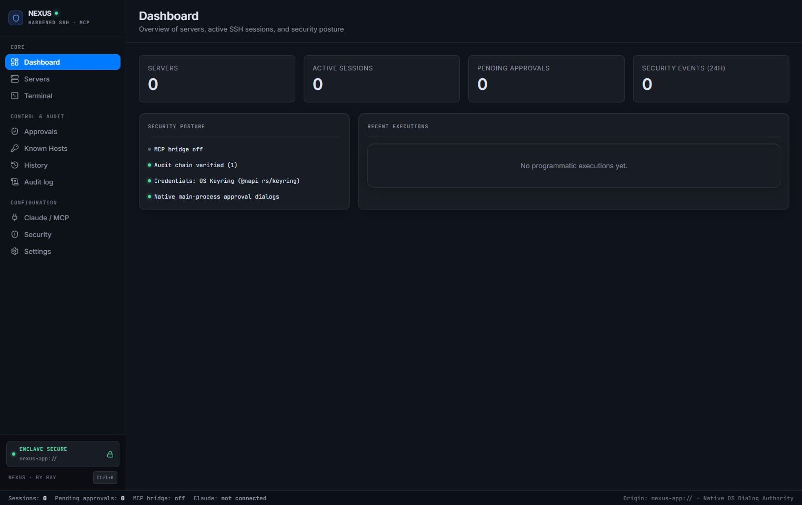
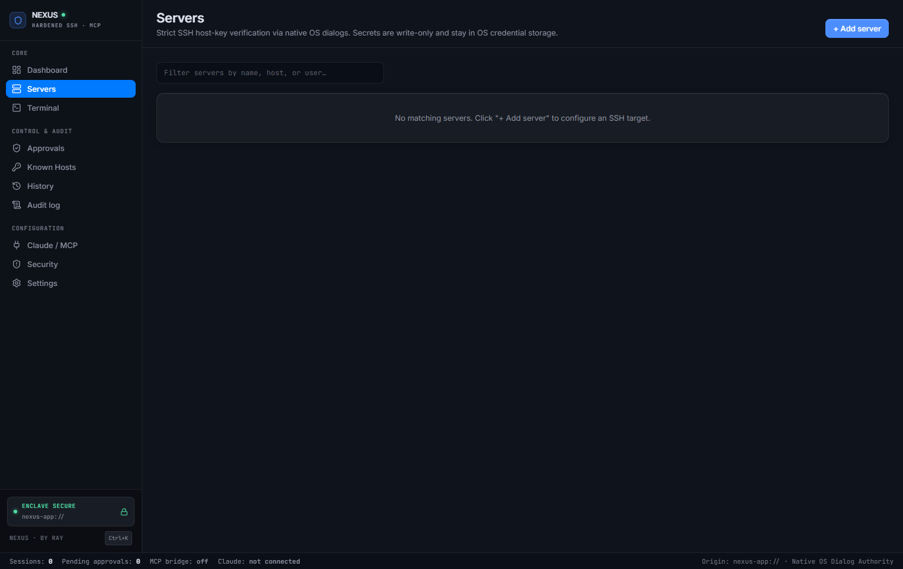
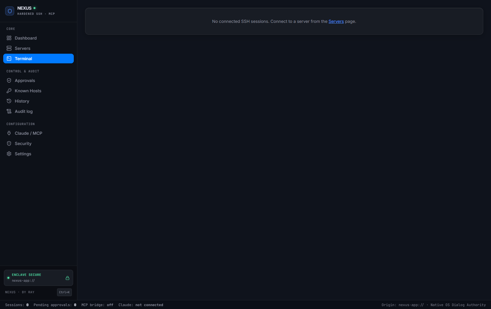
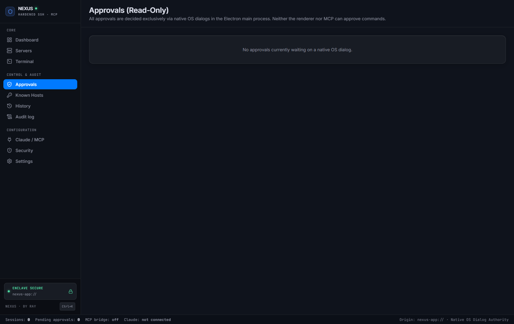
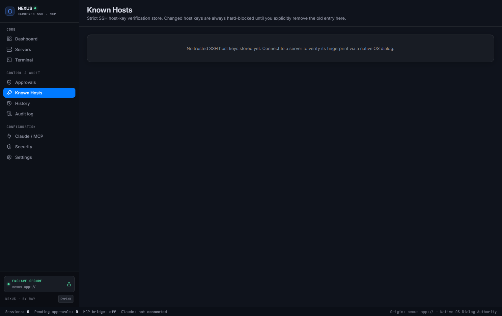
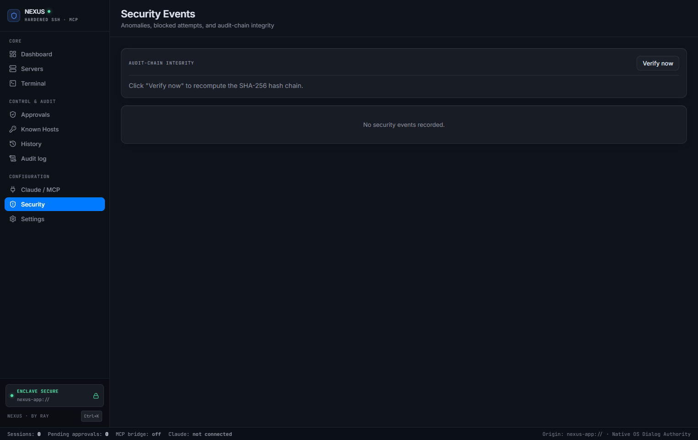
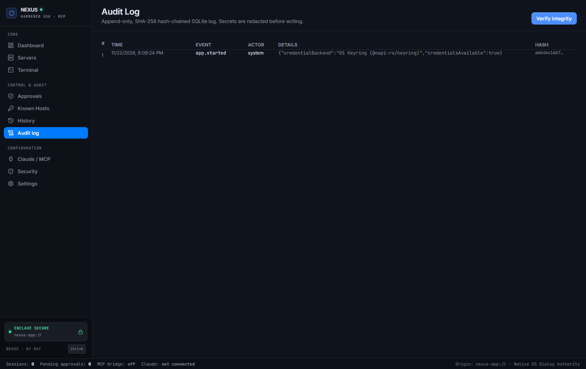
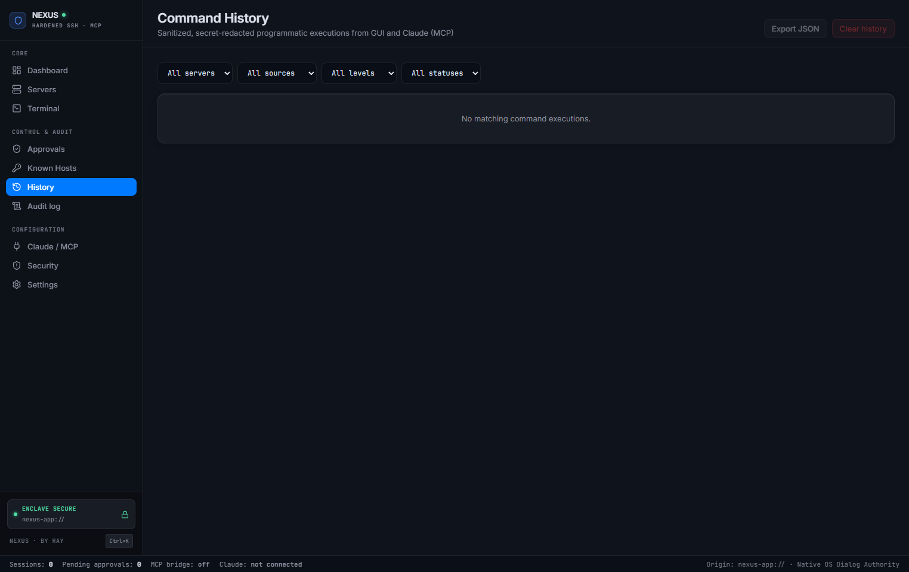
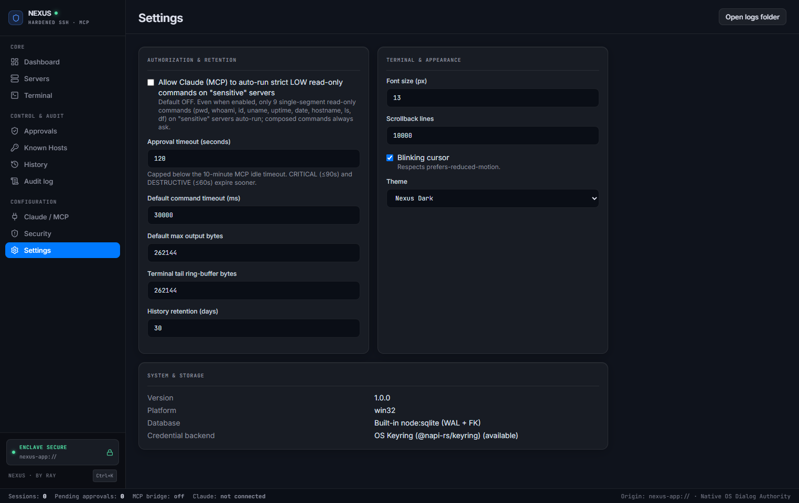

# NEXUS Terminal

**A security-focused Windows SSH terminal with native command authorization, strict host-key
verification, and a restricted Claude Code MCP integration.**

NEXUS is an Electron desktop SSH client built on the assumption that a terminal is a console on
someone else's machine, and that the interesting security decisions should not happen in a web
page. SSH connections, credentials, the database, the audit log — and every approval decision —
live in the Electron main process. The UI is a sandboxed renderer that can only ask.

Created and maintained by **Ray**. MIT licensed.

---

## Contents

- [Overview](#overview)
- [Capabilities](#capabilities)
- [Security architecture](#security-architecture)
- [Screenshots](#screenshots)
- [System requirements](#system-requirements)
- [Download and install](#download-and-install)
- [First launch](#first-launch)
- [Connecting to a server](#connecting-to-a-server)
- [Host-key verification](#host-key-verification)
- [Command authorization](#command-authorization)
- [Claude Code / MCP setup](#claude-code--mcp-setup)
- [Where your data lives](#where-your-data-lives)
- [Backup and restore](#backup-and-restore)
- [Upgrading](#upgrading)
- [Uninstall](#uninstall)
- [Troubleshooting](#troubleshooting)
- [Security limitations](#security-limitations)
- [Building from source](#building-from-source)
- [Documentation](#documentation)
- [License and contributing](#license-and-contributing)

---

## Overview

Most SSH clients treat "trust this host key" and "run this command" as UI events. NEXUS treats
them as authorization decisions that the UI is not allowed to make:

- **Host keys** are pinned per `(host, port, key type)` on first use, and a *changed* key blocks
  the connection outright. There is no override, no setting, and no environment variable.
- **Commands run on your behalf** — from the Run Command drawer or from Claude Code through MCP
  — pass through one shared pipeline that raises a native OS dialog. The default answer is Deny.
- **Everything privileged** (SSH, credentials, SQLite, audit log) is in main, reachable from the
  renderer only through a frozen, origin-pinned preload surface.

NEXUS is not a general-purpose automation platform and does not try to be. It does one thing:
give you a defensible audit trail for the commands you send to a server, whether you typed them
or an assistant proposed them.

## Capabilities

| Area | What you get |
| --- | --- |
| Terminal | Full interactive PTY over `ssh2` with xterm.js, resize, search-in-buffer, scrollback |
| Servers | Saved hosts with per-server key path, passphrase handling, and per-server MCP access toggle |
| Authorization | Native approve/deny dialog for every programmatic command, hashed arguments, 60s timeout |
| Host keys | Strict verification, first-use prompt, hard block on mismatch, editable Known Hosts list |
| History | Command history with retention pruning; approval records; append-only hash-chained audit log |
| Audit log | SHA-256 chained `audit_log` with an in-app integrity verification action |
| Credentials | Windows Credential Manager via `@napi-rs/keyring`, `safeStorage` fallback, never plaintext |
| MCP | Exactly five tools for Claude Code, over an HMAC-authenticated local named pipe |
| Hardening | `nexus-app://` only, strict CSP, sandbox + context isolation, Electron fuses flipped |

## Security architecture

```
┌──────────────────────────────┐        ┌───────────────────────────────────┐
│ Renderer (sandboxed React)   │        │ Main process                      │
│  no Node, no fs, no IPC      │◀──────▶│  IPC registry (origin + wc.id)    │
│  access beyond the preload   │ frozen │  Services ─ ExecutionService      │
└──────────────────────────────┘ preload│      ├─ CommandAuthorizer          │
                                        │      ├─ HostKeyVerifier           │
┌──────────────────────────────┐        │      ├─ CredentialStore            │
│ Claude Code                  │        │      ├─ SQLite (node:sqlite, WAL)  │
│  nexus-mcp.mjs (stdio)       │◀──────▶│      └─ AuditLog (hash chain)      │
└──────────────────────────────┘ HMAC   └───────────────────────────────────┘
                                 named pipe            │
                                                       ▼
                                                  ssh2 → server
```

- **No `file://`.** The renderer is served from a custom privileged scheme, `nexus-app://app`,
  by a handler that rejects traversal, backslashes, NUL bytes and symlink escapes.
- **Strict CSP, pinned origin, pinned `webContents.id`.** Every IPC message is validated against
  both the trusted origin and the single expected window.
- **Native dialogs, main process only.** Approval and host-key prompts are OS dialogs whose
  default button is Deny/Reject. Neither the renderer nor MCP has an IPC path that resolves them.
- **The MCP process is deliberately thin.** It is built separately with `electron`, `ssh2`,
  `node:sqlite` and `@napi-rs/keyring` marked external, then scanned at build time to prove none
  of them were bundled. It has no database access and no SSH code.

Full detail: [`docs/SECURITY.md`](docs/SECURITY.md) (threat model and accepted limitations) and
[`docs/ARCHITECTURE.md`](docs/ARCHITECTURE.md) (data flows, channels, lifecycle).

## Screenshots

These screenshots were captured from the running NEXUS Electron application. The local profile
had no saved servers or command executions, so those pages show the application's real empty
states; no SSH servers were contacted. The Claude Code / MCP page is not pictured because its
registration instructions display a machine-specific filesystem path.

### Command Center



### Infrastructure Management

| Server Fleet | Terminal Workspace |
| --- | --- |
|  |  |

### Security and Authorization

| Authorization Center | Trusted Hosts |
| --- | --- |
|  |  |

| Security Operations | Audit Trail |
| --- | --- |
|  |  |

### Execution History



The Claude Code / MCP page is not pictured because its registration instructions include a
machine-specific executable path. Its setup and five-tool interface are documented in the
[Claude Code / MCP setup section](#claude-code--mcp-setup).

### System Configuration



Native approval and host-key prompts are operating-system dialogs; NEXUS defaults those decisions
to deny or reject.

## System requirements

| | |
| --- | --- |
| OS | Windows 11 x64 (primary target). Windows 10 x64 is expected to work but is not the tested target. |
| Disk | ~450 MB installed (Electron runtime included) |
| RAM | ~250 MB at idle with one session |
| Network | Needed only to reach the SSH servers you connect to |
| Privileges | None. The installer is per-user and does not require administrator rights. |
| Prerequisites | **For the installed app: none.** No Node.js, npm, Python, compiler or build tools are needed; the runtime is bundled. |

## Download and install

1. Download `NEXUS-Terminal-Setup.exe` from the [Releases](../../releases) page.
2. Verify the download against `SHA256SUMS.txt` in the same release:

   ```powershell
   Get-FileHash .\NEXUS-Terminal-Setup.exe -Algorithm SHA256
   ```

3. Run the installer. It installs for the current user by default
   (`%LOCALAPPDATA%\Programs\nexus-terminal`), lets you choose another directory, creates a Start
   Menu entry and a desktop shortcut, and does not require an administrator prompt.

There is also an unpacked archive, `NEXUS-Terminal-1.0.0-windows-x64-archive.zip`. It is exactly
the installed application directory in a ZIP: extract it anywhere and run `NEXUS Terminal.exe`.
It still stores its data under `%APPDATA%\NEXUS`, so it is an unpacked build rather than a
self-contained portable app with its own settings folder.

### About the SmartScreen warning

Release `1.0.0` is **not code-signed**. Windows will likely show *"Windows protected your PC"*
when you run the installer, because SmartScreen reputation is tied to a signing certificate and
to download volume, and a brand-new unsigned binary has neither.

NEXUS will never ask you to turn off Microsoft Defender or SmartScreen. If you want to run it,
confirm the SHA-256 hash above, then use **More info → Run anyway** on the SmartScreen prompt.
If the hash does not match what the release page lists, do not run the file. Signed builds will
replace this section when a certificate is available; see `docs/DISTRIBUTION-ASSESSMENT.md` for
the signing plan.

## First launch

The app opens on the **Dashboard**. On first run it creates its database and migrations, starts
the local audit log, and probes the credential backend. You can confirm the backend in the status
bar and in `%APPDATA%\NEXUS\logs\nexus.log`:

```
{"level":"info","event":"app.started","meta":{"credentialBackend":"OS Keyring (@napi-rs/keyring)"}}
```

If the backend reads `safeStorage` instead, credentials are still encrypted (DPAPI ciphertext),
but they are stored as file-based ciphertext rather than Credential Manager entries. If it reads
`unavailable`, saving a password fails closed.

## Connecting to a server

1. **Servers → Add server.** Enter host, port (default 22), username, and optionally a path to a
   private key file. Private keys are never read by the renderer or copied into the database:
   only the path is stored, and the file is read in main at connect time and zeroed afterwards.
2. **Authentication.** Use a password (stored in Credential Manager), a passphrase-protected key,
   or an unencrypted key. Passwords are never written to SQLite.
3. **Connect.** The terminal opens a PTY and you type into it directly. Keystrokes in the
   interactive terminal are *not* approval-gated — see
   [Security limitations](#security-limitations).
4. **Enable Claude access (optional).** Per server, toggle *Allow Claude (MCP) to access this
   server*. Without it, MCP requests for that server are denied before any SSH call happens.

## Host-key verification

- **First connection to an unknown host:** a native dialog shows the algorithm and SHA-256
  fingerprint and defaults to **Reject**. Approving pins the key for `host:port:keyType`.
- **Known host, matching key:** connects without prompting.
- **Known host, changed key:** the connection is blocked with *"HOST KEY CHANGED — CONNECTION
  BLOCKED"*. There is no override button, no setting and no flag that disables verification.
- **Recovery:** after confirming the key change out-of-band with the server administrator, open
  **Known Hosts**, delete the pin for that host, and reconnect to get a fresh first-use prompt.

## Command authorization

Two paths can run a command on your behalf:

| Path | Goes through approval? |
| --- | --- |
| Run Command drawer in the GUI | Yes — native dialog, default Deny |
| `nexus_run_command` from Claude Code (MCP) | Yes — same dialog, same pipeline |
| Typing into an interactive terminal | No — you are the approver |

The dialog shows the server, the full command text, and a hash of the arguments. It times out to
Deny after 60 seconds. An approval is recorded in `approvals` and the execution in `executions`;
both feed the audit log. Rejecting a request performs no SSH call at all.

## Claude Code / MCP setup

NEXUS exposes exactly five tools:

| Tool | Purpose |
| --- | --- |
| `nexus_list_servers` | List servers explicitly enabled for MCP (public information only) |
| `nexus_list_sessions` | List connected SSH sessions on MCP-enabled servers |
| `nexus_run_command` | Request a command through the native approval dialog |
| `nexus_get_history` | Get sanitized, redacted command history (limit ≤ 100) |
| `nexus_read_terminal_tail` | Read a bounded, ANSI-stripped and redacted tail of a connected session |

Setup:

1. Open **Claude / MCP** in the app. The page shows the ready-to-paste registration command and
   the location of the bundled `nexus-mcp.mjs`, and shows *Bridge listening* once the named pipe
   is up.
2. Register the MCP server with Claude Code using the command shown (it points at the bundled
   MCP server inside the installed app, so no separate Node.js install is needed).
3. Restart Claude Code. The status bar shows `Claude: connected (N)` with the number of
   authenticated clients.
4. Enable MCP access per server in **Servers**.

The pipe is `\\.\pipe\nexus-bridge-<hash>-<random>`, authenticated with a fresh 256-bit HMAC
secret per launch, published in `%APPDATA%\NEXUS\bridge.json` (deleted on quit). It is not a
network listener: nothing is exposed on TCP. Details: [`docs/MCP.md`](docs/MCP.md).

## Where your data lives

Electron `userData` — `%APPDATA%\NEXUS` (the app sets its name to `NEXUS`, so this is not
`%APPDATA%\NEXUS Terminal`):

| Path | Contents |
| --- | --- |
| `nexus.db` (+ `-wal` / `-shm`) | Servers, sessions, executions, approvals, known hosts, settings, audit log |
| `logs\nexus.log` | Rotated, redacted JSON-lines log |
| `bridge.json` | Per-launch MCP endpoint + secret; removed on quit |

Credentials are **not** in the database. Passwords and passphrases live in Windows Credential
Manager (or as `safeStorage` ciphertext). Copying `nexus.db` to another machine does not move
credentials with it, and private key files stay wherever you put them.

## Backup and restore

**Backup:** quit the app, then copy `nexus.db` plus any `nexus.db-wal` / `nexus.db-shm`. Do not
copy while it is running — a WAL-mode copy taken mid-write can be inconsistent. There is no
in-app export.

**Restore:** quit the app, replace `nexus.db`, delete stale `-wal`/`-shm` files, and start it. On
startup the app marks sessions disconnected and fails interrupted executions. The audit hash
chain still verifies for the rows the copy contains, but rows written after the backup are gone
(tail truncation is undetectable by design). Confirm with **Audit log → Verify integrity**. If
the database is corrupt the app refuses to start rather than silently recreating it; delete the
file only if you accept losing the data.

## Upgrading

Run a newer `NEXUS-Terminal-Setup.exe`; it installs over the previous version and keeps
`%APPDATA%\NEXUS` untouched. Database migrations run forward automatically and are idempotent.
Downgrading is not supported: an older build may not understand a newer schema.

## Uninstall

**Settings → Apps → NEXUS Terminal → Uninstall**, or *Apps & features*. The uninstaller removes
the program files, the Start Menu entry and the desktop shortcut.

It does **not** delete `%APPDATA%\NEXUS`. Your database, settings and logs survive an uninstall
by design (`deleteAppDataOnUninstall: false`). Delete that folder yourself only if you intend to
remove every trace, including the audit log.

## Troubleshooting

**SmartScreen blocks the installer.** Expected for an unsigned 1.0.0 — verify the SHA-256, then
*More info → Run anyway*. Never disable Defender or SmartScreen to work around it.

**"OS credential storage is unavailable".** The keyring could not be probed and NEXUS fails
closed instead of falling back to plaintext. Check that Windows Credential Manager is reachable
and that you are running a Windows x64 build (a tree packaged on another platform contains that
platform's native keyring only).

**Host key changed.** The connection is blocked by design. Confirm the change with the server
administrator, then delete the pin in **Known Hosts** and reconnect.

**Bridge listening but Claude reports no connection.** *Listening* only means the pipe is up.
Register the command from the Claude / MCP page, restart Claude Code, and make sure the server
has *Allow Claude (MCP)* enabled. The status bar's connected count is the real signal.

**Blank window when running from source.** Dev mode serves Vite inline scripts while
`src/renderer/index.html` carries a stricter meta CSP; this does not affect the packaged app.
Test the packaged path with `npm run build` and launch Electron, or use the installer.

**App refuses to start after a manual database edit.** It validates the database and stops
rather than recreating it. Restore a backup.

**Where are the logs?** `%APPDATA%\NEXUS\logs\nexus.log` (redacted JSON lines, size-rotated).
*Settings → Open logs folder* opens it.

## Security limitations

Read these before relying on NEXUS for anything that matters. The full list is in
[`docs/SECURITY.md`](docs/SECURITY.md).

- **Interactive keystrokes are not approval-gated.** That is the point of a terminal, but it
  means code executing inside the renderer could type into an open session without a dialog.
  Renderer isolation (sandbox, context isolation, strict CSP, `nexus-app://`, origin-pinned IPC)
  is therefore a primary control, not a nicety.
- **No code signing in 1.0.0.** No SmartScreen reputation, no verified publisher name. Verify
  hashes.
- **No auto-update channel.** Updates are manual downloads. There is no remote code channel,
  which also means no remote-code risk from an updater.
- **Private keys are read from disk at connect time** (then zeroed). No `ssh-agent` integration,
  no hardware-token support.
- **The audit log detects mid-chain tampering, not truncation of the tail.** Deleting the newest
  rows is not detectable from the file alone.
- **Windows x64 is the tested target.** Other platforms build but are not validated for release.

## Building from source

### Prerequisites

For local development and packaging, use:

- **Windows 11 x64.** Build the Windows installer on Windows; the credential dependency uses a
  platform-specific native binary.
- **Git for Windows.** This provides Git and a Windows-compatible terminal.
- **Node.js 22.5.0 or newer** (required for `node:sqlite`).
- **npm 10 or newer.** npm is included with Node.js; update Node.js if its bundled npm is too old.
- **A code editor.** Visual Studio Code is one option, but any editor is suitable.

Open PowerShell or Windows Terminal and check the installed versions:

```powershell
node --version
npm --version
git --version
```

Confirm Node.js is at least `v22.5.0` and npm is at least `10`. Git should print its installed
version.

### Clone the repository

Replace `<REPOSITORY_URL>` with the actual HTTPS or SSH URL of the GitHub repository:

```powershell
git clone <REPOSITORY_URL>
cd nexus-terminal
```

### Install dependencies

```powershell
npm ci
```

`npm ci` installs the exact dependency versions recorded in `package-lock.json`. It is the
reproducible install command for this repository.

### Start development

```powershell
npm run dev
```

This launches the Electron development environment, including the app's development server and
Electron window.

### Verification

Run any of these checks from the repository directory:

| Command | What it checks |
| --- | --- |
| `npm run typecheck` | TypeScript checks for the main/preload and renderer projects without emitting files. |
| `npm run lint` | ESLint checks the repository. |
| `npm test` | Runs the Vitest test suite (unit, renderer, and other tests included in the default configuration). |
| `npm run test:integration` | Runs the integration tests under `tests/integration`. |
| `npm run scan-secrets` | Scans the source tree for likely secrets and forbidden credential files. |
| `npm run build` | Builds the Electron app and separately builds the MCP server bundle. |
| `npm run verify` | Runs typecheck, lint, tests, build, and the secret scan in sequence. |

### Build the Windows installer

```powershell
npm run package
```

This builds the app and packages Windows x64 NSIS installer and ZIP artifacts in `release/`:

- `NEXUS-Terminal-Setup.exe`
- `NEXUS-Terminal-1.0.0-windows-x64-archive.zip`

The ZIP contains the installed application directory, but it is **not a self-contained portable
installation**: app data remains under `%APPDATA%\NEXUS`. The installer and archive must be
built on Windows because the credential dependency includes a platform-specific native binary.

## Documentation

- [`docs/ARCHITECTURE.md`](docs/ARCHITECTURE.md) — system architecture, data flows, IPC, SSH lifecycle, bridge protocol
- [`docs/SECURITY.md`](docs/SECURITY.md) — trust boundaries, threat model, credential handling, accepted limitations
- [`docs/SECURITY-REVIEW.md`](docs/SECURITY-REVIEW.md) — dangerous-API review with per-hit justification
- [`docs/MCP.md`](docs/MCP.md) — the five tools, bridge authentication, manual registration
- [`docs/TESTING.md`](docs/TESTING.md) — command-verified test status
- [`docs/DISTRIBUTION-ASSESSMENT.md`](docs/DISTRIBUTION-ASSESSMENT.md) — packaging audit and code-signing assessment
- [`docs/GITHUB-REPOSITORY-READINESS.md`](docs/GITHUB-REPOSITORY-READINESS.md) — repository hygiene and CI readiness
- [`docs/DISTRIBUTION-REPORT.md`](docs/DISTRIBUTION-REPORT.md) — verification report for the 1.0.0 candidate
- [`CONTRIBUTING.md`](CONTRIBUTING.md) — development workflow and review rules
- [`SECURITY.md`](SECURITY.md) — how to report a vulnerability

## License and contributing

MIT © 2026 Ray. See [`LICENSE`](LICENSE).

Contributions are welcome; read [`CONTRIBUTING.md`](CONTRIBUTING.md) first. Security issues go
through the private channel described in [`SECURITY.md`](SECURITY.md), never a public issue.
